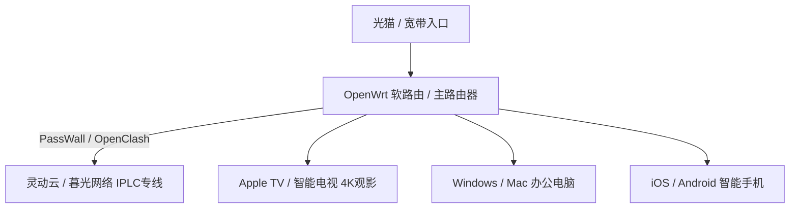

## 引言：多设备时代的科学上网痛点

在当今数字化生活中，一个典型的家庭或个人往往拥有多台网络设备：手机（iOS/Android）、电脑（Windows/Mac）、iPad、智能电视/Apple TV 以及 OpenWrt 路由器。然而，许多机场在套餐说明中明确限定了**“仅限 2 台设备同时在线”**或**“严禁共享 IP 连接”**，一旦超标就会触发风控被封禁账号。

如何挑选一家**不限在线设备数、允许家庭共享、高并发且带宽充足**的高性价比机场？本文为您进行深度剖析。

---

## 机场对“在线设备数”的两种风控限制机制

在选购前，必须搞清机场后台对设备数量的拦截原理：

1. **IP 数量限制（IP Connect Limit）**：
   机场限制的是同时从多少个不同的公网 IP 地址连接服务器。例如限制 3 个公网 IP，这意味着如果你家里所有设备都连接在同一个路由器 Wi-Fi 下（公用一个家庭宽带外网 IP），所有设备在机场后台仅计为 **1 个 IP**，可以任意连接！但如果你出门在外用手机 4G/5G（独立 IP）连接，就会占用第 2 个 IP 额度。
2. **设备客户端连接数限制（Device Limit）**：
   机场通过客户端发送的设备特征码来限制在线设备数，超过数量直接提示“超限拒绝”。

---

## 适合多设备与家庭共享的 4 大核心机场

根据多设备高并发、大流量及智能分流的需求，我们推荐以下 4 家机场：

### 1. 暮光网络 —— 多设备大流量并发首选
- **官网注册**：[👉 注册暮光网络多设备套餐](https://varnexa.twilightaff.com/#/?code=KvGly3jY) *(优惠码：`mm88`)*
- **核心优势**：提供 1500GB/月 超大流量包，支持多设备同时高并发连接。晚高峰带宽极其充沛，4K 影视在电视盒子与手机上同时播放依然丝滑卡顿。
- **深度测评**：[阅读暮光网络测评](/providers/twilight-network/index.html)

### 2. 灵动云 —— 软路由全家共享物理专线
- **官网注册**：[👉 注册灵动云家庭专线](https://varnexa.lingdongaff.com/#/?code=JoIy7bO1) *(优惠码：`lingdong88`)*
- **核心优势**：采用高端 IPLC 专线，配合 OpenWrt 软路由部署（PassWall / OpenClash），家庭网关一键接管全屋设备。0 丢包且完美解锁 Apple TV、Netflix 及 AI 平台。
- **深度测评**：[阅读灵动云测评](/providers/lingdong-cloud/index.html)

### 3. 微风网络 Breezenet —— 多终端智能分流
- **官网注册**：[👉 注册微风网络](https://edp01.breezenetaff.com/#/?code=He4n3zxg) *(优惠码：`breeze66`)*
- **核心优势**：智能 BGP 负载均衡，针对智能电视、手机与电脑的不同流量需求自动匹配最佳节点，避免单节点拥堵。
- **深度测评**：[阅读微风网络测评](/providers/breezenet/index.html)

### 4. 飞猫云 —— 经济型多设备入门方案
- **官网注册**：[👉 注册飞猫云](https://flycat1.flycatvipaff.cc/#/?code=FOdfcRFH) *(优惠码：`flycat888`)*
- **核心优势**：性价比极高，自研客户端支持跨平台快捷配置，适合学生宿舍或个人多设备轻度共享。
- **深度测评**：[阅读飞猫云测评](/providers/flycat-cloud/index.html)

---

## 家庭多设备科学上网最佳实践方案

为了让全家设备更稳定地科学上网，建议采用以下架构：

### 1. 软路由（OpenWrt / PassWall / OpenClash）全屋代理
将机场订阅导入到软路由中，开启局域网透明代理。家里所有连入 Wi-Fi 的设备（包括无法安装翻墙软件的扫地机器人、Apple TV、PS5 游戏机）均可自动实现科学上网。

### 2. 客户端规则分流（避免流量浪费）
为手机和电脑开启“规则模式（Rule Mode）”，国内流量（微信、淘宝、爱奇艺）直连不消耗机场流量，仅海外网站（Google、YouTube、ChatGPT）走机场节点。可参考 [Clash 分流规则配置教程](/jiaocheng/clash-rules-routing-setup/index.html)。

---

## 总结

多设备共享科学上网，核心在于选择**流量充沛、允许高并发且线路稳定的专线/中转机场**。

- **多设备大流量首选**：[暮光网络官网](https://varnexa.twilightaff.com/#/?code=KvGly3jY)
- **软路由全家共享首选**：[灵动云 IPLC 专线](https://varnexa.lingdongaff.com/#/?code=JoIy7bO1)
- **查阅全站测评排行榜**：[2026 机场排行榜](/jichang-tuijian/2026-airport-ranking-list/index.html)
